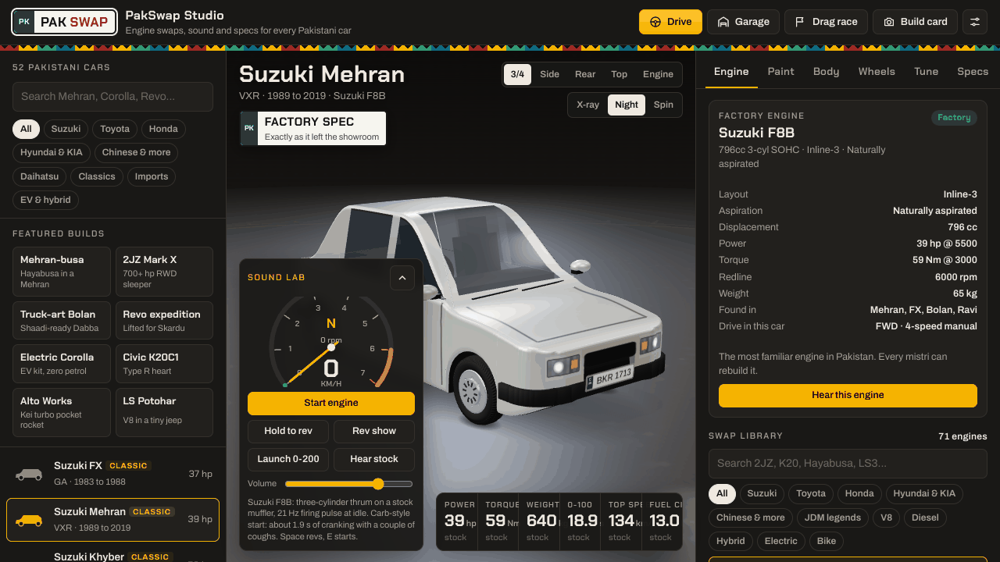
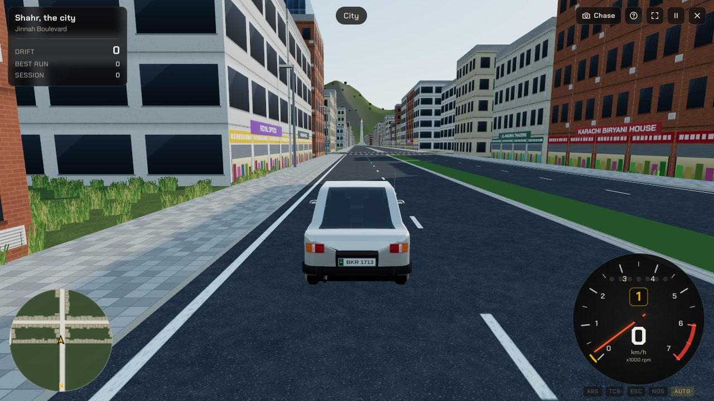
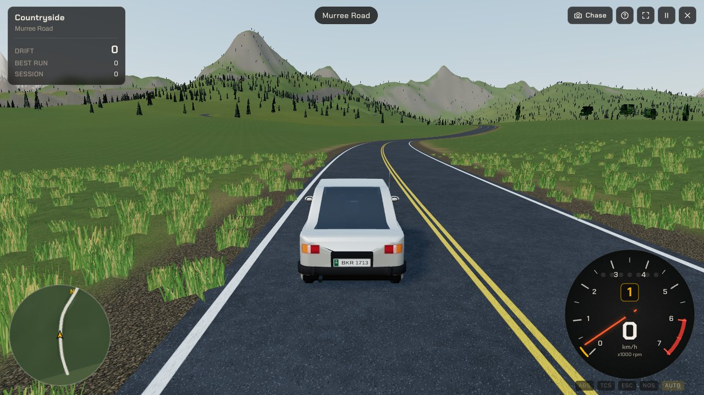
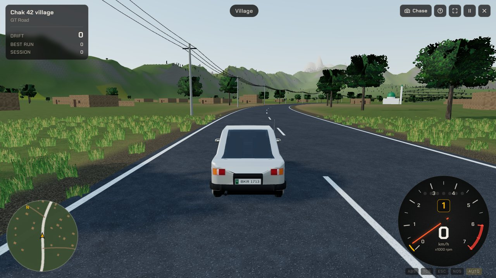
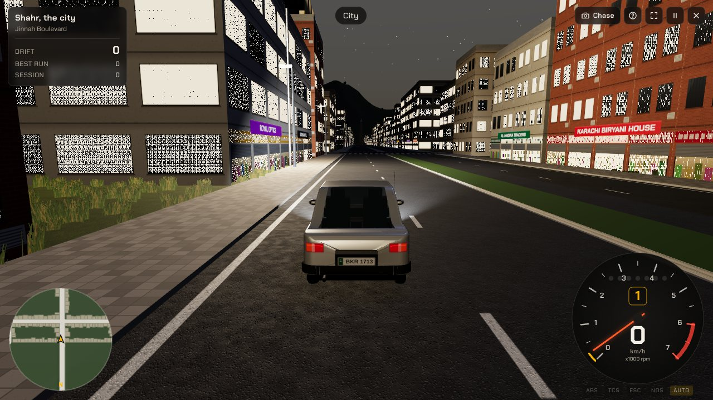
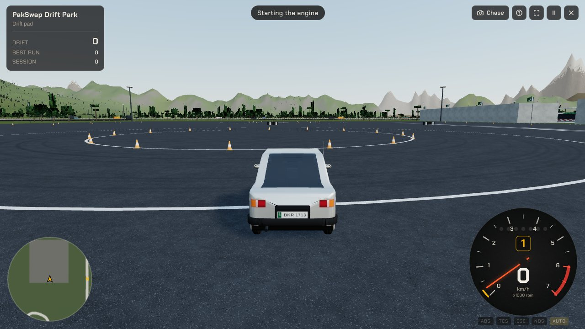
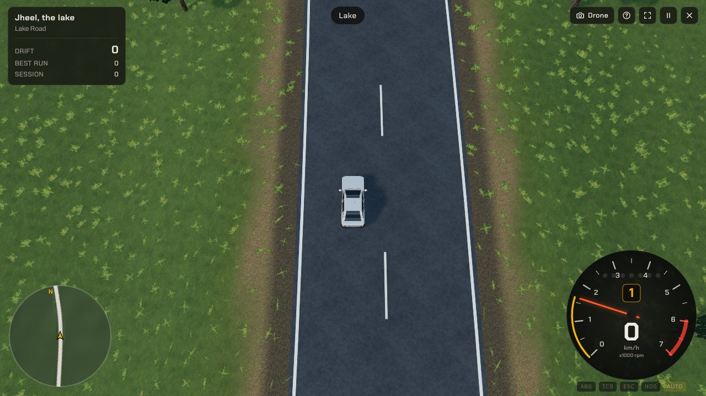

# PakSwap Studio

3D engine-swap and modding studio for Pakistani cars, with a drivable open world.
52 cars, 71 engines, live synthesised engine sound, paint and liveries (including truck art),
body kits, wheels, tuning, and a physics-based spec sheet with pros, cons, swap difficulty,
dyno and drag race. Everything runs offline, in the browser or as a desktop app.



## Download

- **[Latest release](../../releases/latest)**: Windows `.exe` (portable, no install), Linux `.AppImage`
  and `.tar.gz`.
- **Any device:** download `PakSwap-Studio.html` from this repo and open it. The whole app is in that
  one file, no install and no internet needed.
- **Linux menu entry:** download the `.tar.gz` and the `install-linux.sh` from this repo into the same
  folder, then run `bash install-linux.sh`. It installs into your home folder, no sudo. Remove it again
  with `bash install-linux.sh --uninstall`.

## The studio

- **Engine start:** every car and engine starts differently: starter solenoid click, the "gar gar gar"
  of the starter fighting each compression stroke, coughs on carburettor cars, glow plugs on diesels,
  a silent motor spin-up on hybrids, then the catch, the rev flare and a cold fast idle that settles.
  Switching the engine off spins it down through its compression and it rocks to a stop.
- **Swap anything:** drop a 1300cc G13 into a Mehran, a 2JZ into a Corolla, a bike engine into a
  Charade. Every swap is checked for fitment, mounts, gearbox, driveshafts, cooling and wiring, and
  rated for difficulty and cost.
- **Specs that follow the build:** weight, power and torque curves, 0 to 100, quarter mile, top speed,
  fuel average, and a verdict with pros and cons.
- **Real 3D models:** Body tab, *Real 3D model*: load a GLB, glTF, ZIP, FBX or OBJ (with MTL) model of
  the car, or drop it on the 3D view. It is turned to face forward, scaled to the car's real length, its
  body paint follows the Paint tab and its wheels spin in launches. Engine swaps, sound, X-ray and specs
  keep working. Models are saved per car in the browser on that device. Use models you own or have a
  licence for.

## Drive mode (open world)

Press **Drive** in the top bar to take the car you built out into a 3D open world, with its engine,
weight, power, tyres and gearbox exactly as configured in the studio. The roads are yours alone: no
other cars, just you, the car and the map.

| | |
| --- | --- |
|  |  |
|  |  |
|  |  |

- **The world (about 5 x 5 km):** a Karachi-style city (grid streets, shops with signboards, footpaths,
  street lights, Jinnah Boulevard, Iqbal Avenue and the Chowk roundabout), the M-9 motorway with a toll
  plaza and a service area, a Murree-style mountain road with pine forest, switchbacks and a viewpoint,
  the GT Road through a village (mud houses, fields, a mosque, a dhaba with truck-art trucks), a lake
  road, and the drift park with a race circuit, a drift pad and cones. Pause menu > map to jump anywhere.
- **Physics:** weight transfer, combined-slip tyres, slopes, kerbs and surfaces (asphalt, concrete,
  gravel, grass, dirt, sand, water), clutch, automatic, CVT, manual or EV drive, limited-slip
  differentials, ABS, traction and stability control, nitrous, and crashes. Driving aids: Drift
  (assisted slides), Grip (road car with TCS and ESC) or Sim (no help).
- **Sound:** your engine through the gears, tyre squeal and scrub, gravel and grass rumble, kerbs,
  scraping walls, impacts, wind and your horn.
- **Time of day:** afternoon, evening and night (street lights, headlights, stars and moon).
- **Cameras:** chase, far chase, hood, bumper, TV, drone and orbit. Lap timer on the circuit and a drift
  score everywhere.

### Drive controls

| Action | Keyboard | Gamepad |
| --- | --- | --- |
| Throttle / brake and reverse | W / S or arrow keys | Right / left trigger |
| Steer | A / D or arrow keys | Left stick |
| Handbrake | Space | A / Cross |
| Nitrous | N or Right Shift | X / Square |
| Horn | H | B / Circle |
| Shift up / down (manual) | E / Q | Bumpers |
| Camera | C (mouse drag or right stick to look) | Y / Triangle |
| Look back | V | Right stick click |
| Reset car to the road | R | Select |
| Gearbox auto / manual | M | D-pad down |
| Headlights | L | D-pad up |
| Engine on / off | I | |
| Driving aids | K | |
| Time of day | T | |
| Pause menu and map | Esc or P | Start |
| Help / fullscreen | F1 / F | |

On phones and tablets on-screen pedals, steering and handbrake buttons appear.

Studio controls: Space = rev, E = start or stop the engine, X = X-ray the engine bay, 1 to 5 = camera
views, Esc = close dialogs.

## Performance and old hardware

The app is built to stay smooth on old office PCs, not only on gaming machines.

- **Draws only when needed:** an idle studio uses no GPU time; frames are drawn when the camera or
  the car changes.
- **Auto quality:** Settings > Graphics quality > *Auto* (the default) watches the frame rate and
  trades render resolution, then effects, for smoothness. *Low* turns off shadows, reflections and
  bloom and shortens the draw distance. Settings > Interface > *Solid* switches off the glass blur.
- **Open world in cells:** scenery is batched per map cell and culled, so only what the camera or
  the sun's shadow can reach is drawn.
- **Sound off the main thread:** the engine synthesiser runs in an audio worklet as compiled Rust
  (WebAssembly), with the JavaScript version as a fallback.
- **Graphics chip:** any GPU with WebGL 2 (DirectX 10.1 / OpenGL 3.3 class and newer). Chips older
  than that, such as first-generation Intel HD Graphics, have no WebGL 2; the desktop app then uses
  the built-in software renderer on the Low tier. The studio stays usable that way, but the open
  world will not reach a high frame rate without a GPU.

## Build from source

Node.js 18 or newer.

```bash
npm install
npm run build                  # -> dist/index.html, one offline file with everything in it
```

The sound core is Rust (`native/engine-dsp`). The compiled module is committed at
`src/audio/engine_dsp.wasm`, so Rust is only needed if you change it:

```bash
rustup target add wasm32-unknown-unknown
npm run build:wasm             # rebuilds src/audio/engine_dsp.wasm
npm test                       # checks the Rust and JavaScript synthesisers give the same samples
```

Desktop apps (Electron):

```bash
npm run desktop                # Windows portable .exe + Linux AppImage and .tar.gz, into desktop/release/

# or one platform at a time
node build.mjs
cp dist/index.html desktop/app/index.html
cd desktop && npm install
npm run dist:linux             # AppImage + tar.gz (+ deb when fpm is available)
npm run dist:win               # portable .exe (+ NSIS installer on Windows, or with wine)
```

Windows builds are made on Windows, Linux builds on Linux. Pushing a tag such as `v1.2.0` makes GitHub
Actions build both and attach them to a release, so no local Electron toolchain is needed:

```bash
git tag v1.2.0
git push origin v1.2.0
```

## Project layout

```
src/
  data/cars.js        52 Pakistani cars (dimensions, weight, tyres, gearbox, fuel average)
  data/engines.js     71 engines (power/torque curves, weight, size, layout, sound profile)
  data/parts.js       every modification option and the default build
  sim/powertrain.js   torque curves, turbo/supercharger/nitrous effects, gearboxes
  sim/vehicle.js      mass, aero, traction, gearing, 0-100 / quarter mile / top speed simulation
  sim/shape.js        body proportions shared by the 3D model and the fitment check
  sim/analysis.js     stock vs build metrics, swap difficulty, pros/cons, verdict, ratings
  three/carModel.js   procedural 3D car (lofted body, projected lamps/grille/plates, kits)
  three/wheels.js     procedural rims and tyres
  three/engineModel.js procedural engines (inline, V, boxer, rotary, bike, electric)
  three/importer.js   loading, orienting and fitting user 3D models (GLB/glTF/ZIP/FBX/OBJ)
  three/scene.js      studio, lighting, camera
  vendor/draco/       Draco mesh decoder (Apache 2.0) inlined for compressed glTF models
  audio/dsp.js        engine sound synthesiser, JavaScript reference (AudioWorklet),
                      starter/cranking model and per-car, per-engine sound profiles
  audio/dspWasm.js    wrapper for the Rust/WebAssembly build of the synthesiser
  audio/engineAudio.js audio graph + engine model (glow, crank, catch, flare, idle, coast)
  ui/charts.js        dyno, acceleration, tachometer, drag strip
  drive/drive.js      drive mode: physics loop, cameras, sound hookup, effects, laps, drift score
  drive/physics.js    vehicle dynamics (tyres, load transfer, drivetrain, aids, collisions)
  drive/openworld.js  the open world: terrain, road network, city, motorway, mountains, village, lake
  drive/terrain.js    noise, heightfield and road carving
  drive/owView.js     open-world rendering (terrain LOD, roads, buildings, trees, grass, props)
  drive/track.js      drift park and circuit layout, collision world
  drive/sky.js        sky, sun, fog, clouds, stars and moon for each time of day
  drive/hud.js        speedo, rev counter, radar, world map, menus, touch controls
  drive/input.js      keyboard, mouse, gamepad and touch input
  main.js             app controller
  template.html       page shell and styles
native/engine-dsp/    the synthesiser core in Rust (compiled to WebAssembly)
test/dsp-parity.mjs   Rust vs JavaScript synthesiser comparison
build.mjs             bundles everything into dist/index.html (single offline file)
desktop/              Electron shell for the Windows and Linux builds
install-linux.sh      installs the Linux build into your home folder and the applications menu
```

## Adding a car or engine

Add an entry to `src/data/cars.js` (pick a `body` template: kei, tallboy, hatch, hothatch, sedan,
fastback, suv, bigsuv, jeep, pickup, van) or to `src/data/engines.js`, then run `npm run build`.
The 3D model, physics, sound and pros/cons are generated automatically from the numbers.

To fine-tune a silhouette, add a `shape` object that overrides the template, for example the Mehran uses
`shape: { rear: 'notch', cowl: 0.3, ws: 36, roof: 0.4, rw: 45, minDeck: 0.22 }` (windscreen and rear-window
angles in degrees, cowl and roof as fractions of the wheelbase). `doors: 3` gives a three-door side layout.

## Notes

Factory figures follow published Pakistani-market specs. Performance numbers are simulated estimates,
not manufacturer claims. Car names and brands belong to their owners and are used here to describe the
vehicles. No part of the app needs an internet connection.

MIT licensed, see [LICENSE](LICENSE).
